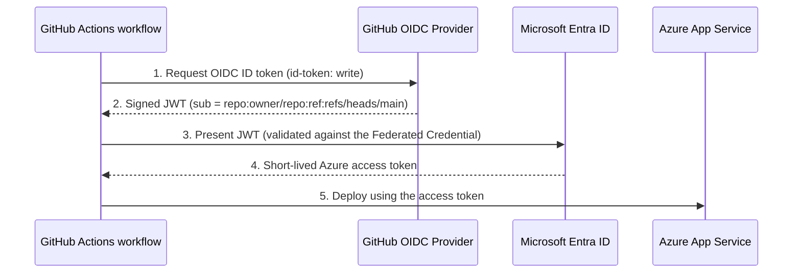

# 🔐 Azure Secretless CI/CD Hands-on Lab

🌐 [한국어](README.md) | **English**

A step-by-step lab that shows how to deploy an app from GitHub Actions to Azure **without storing a single password, key, or publish profile** (secretless).

- ⏱ Time: ~40 minutes
- 💰 Cost: App Service B1 (a few cents if you clean up afterwards). You can try `SKU=F1` for the free tier (may be unavailable depending on subscription quota)
- 🧰 Tech: GitHub Actions, Azure App Service, Microsoft Entra ID **Workload Identity Federation (OIDC)**

## 1. Why secretless?

| | Classic (SP password / Publish Profile) | **Secretless (OIDC)** |
|---|---|---|
| Stored in GitHub | Long-lived secret | **Nothing** (only IDs, which are not secret) |
| Impact of a leak | Anyone can access Azure until it expires | Tokens expire in minutes and are only issued to a specific repo/branch |
| Secret rotation | Manual, periodic | **Not needed** |
| Scope restriction | Hard | Per repo / branch / environment |

### How it works



Key idea: you pre-register (Federated Credential) in Azure that **"a workflow from the main branch of this GitHub repo is trusted"**, so no password ever needs to be exchanged.

## 2. What's inside

```
.
├── .devcontainer/               # Codespaces dev environment (az, gh, Node 22)
├── app/                         # Sample Node.js app (no external dependencies)
├── .github/workflows/deploy.yml # build → test → OIDC login → deploy
├── scripts/setup-azure.sh       # (optional) automates the Azure setup
└── scripts/cleanup-azure.sh     # removes lab resources
```

## 3. Prerequisites

- An Azure subscription (permission to create resources **and register Entra ID apps**; subscription `Owner` or `User Access Administrator` is needed to assign roles)
- A GitHub account
- **GitHub Codespaces (recommended)** — a dev environment with `az`, `gh`, and Node.js 22 preinstalled is set up automatically. (Alternatives: [Azure Cloud Shell](https://shell.azure.com) or a local `az` CLI 2.60+)

## 4. Lab

### Step 0. Create your own repository

1. Click **Use this template** (or **Fork**) at the top of this repo to create a copy under your account.
2. Note the repo name, referred to below as `<OWNER>/<REPO>`, e.g. `octocat/azure-secretless-cicd-lab`.

> Forked repos have Actions disabled by default. Open the **Actions** tab and click *I understand my workflows, go ahead and enable them*.

**Open Codespaces:** in your own repo click **Code → Codespaces → Create codespace on main**. (Open it from **your copy**, not the template original.)

[](https://codespaces.new/Taeyangmoon/azure-secretless-cicd-lab) ← only for quickly browsing the original repo

In the Codespaces terminal, log in to Azure (no browser pop-up there, so use the device code flow).

```bash
az login --use-device-code
az account show -o table      # confirm it's the right subscription
```

> 💡 To preview the app locally, run `cd app && npm start` and open the port 8080 link from the notification.

Prepare variables in your terminal (used by every command below).

```bash
GITHUB_REPO="${GITHUB_REPOSITORY:-<OWNER>/<REPO>}"   # auto-filled in Codespaces
RG="rg-secretless-lab"
LOCATION="koreacentral"
APP_NAME="secretless-lab-$RANDOM$RANDOM"   # must be globally unique
```

> ⚡ **Shortcut:** to do Steps 1–3 at once, run `./scripts/setup-azure.sh` (outside Codespaces: `GITHUB_REPO=<OWNER>/<REPO> ./scripts/setup-azure.sh`) and jump to Step 4. To really understand the flow, we recommend doing them one by one.

### Step 1. Create the Azure Web App

```bash
az group create -n $RG -l $LOCATION
az appservice plan create -g $RG -n plan-$APP_NAME --is-linux --sku B1
az webapp create -g $RG -p plan-$APP_NAME -n $APP_NAME --runtime "NODE:22-lts"
```

Open `https://$APP_NAME.azurewebsites.net` and confirm the default page loads.

### Step 2. Entra ID app + Federated Credential (⭐ the core step)

Create the "identity" GitHub Actions will use in Azure, and register **which GitHub workflow is trusted**.

```bash
# 1) Register the app and create its service principal
CLIENT_ID=$(az ad app create --display-name "sp-github-$APP_NAME" --query appId -o tsv)
az ad sp create --id $CLIENT_ID

# 2) Look up the subject prefix (new repos may include immutable IDs, e.g. repo:<OWNER>@<ID>/<REPO>@<ID>)
SUB_PREFIX=$(gh api repos/$GITHUB_REPO/actions/oidc/customization/sub --jq .sub_claim_prefix 2>/dev/null || echo "repo:$GITHUB_REPO")
echo $SUB_PREFIX

# 3) Federated Credential: "trust the main branch of this repo"
az ad app federated-credential create --id $CLIENT_ID --parameters '{
  "name": "github-main",
  "issuer": "https://token.actions.githubusercontent.com",
  "subject": "'$SUB_PREFIX':ref:refs/heads/main",
  "audiences": ["api://AzureADTokenExchange"]
}'
```

| Field | Meaning |
|---|---|
| `issuer` | The GitHub OIDC provider that issues tokens |
| `subject` | **Who** is trusted. The repo and branch must match exactly |
| `audiences` | Fixed value for Azure AD token exchange |

> ✅ Notice that we **never created a password** (`--password`, or the secret from `az ad sp create-for-rbac`).

### Step 3. Grant least privilege

Grant access to the **single Web App** only (subscription-wide `Contributor` is too broad).

```bash
SP_OBJECT_ID=$(az ad sp show --id $CLIENT_ID --query id -o tsv)
WEBAPP_ID=$(az webapp show -g $RG -n $APP_NAME --query id -o tsv)

az role assignment create \
  --assignee-object-id $SP_OBJECT_ID \
  --assignee-principal-type ServicePrincipal \
  --role "Website Contributor" \
  --scope $WEBAPP_ID
```

### Step 4. Register values in GitHub (**Variables**, not Secrets)

Print the values:

```bash
echo "AZURE_CLIENT_ID       = $CLIENT_ID"
echo "AZURE_TENANT_ID       = $(az account show --query tenantId -o tsv)"
echo "AZURE_SUBSCRIPTION_ID = $(az account show --query id -o tsv)"
echo "AZURE_WEBAPP_NAME     = $APP_NAME"
```

In your repo go to **Settings → Secrets and variables → Actions → Variables tab → New repository variable** and add the four values.

Or with the `gh` CLI:

> ⚠️ The default `GITHUB_TOKEN` in Codespaces can't create Variables. First run `unset GITHUB_TOKEN && gh auth login -h github.com -p https -w`, or use the web UI above.

```bash
gh variable set AZURE_CLIENT_ID       --body "$CLIENT_ID" -R $GITHUB_REPO
gh variable set AZURE_TENANT_ID       --body "$(az account show --query tenantId -o tsv)" -R $GITHUB_REPO
gh variable set AZURE_SUBSCRIPTION_ID --body "$(az account show --query id -o tsv)" -R $GITHUB_REPO
gh variable set AZURE_WEBAPP_NAME     --body "$APP_NAME" -R $GITHUB_REPO
```

> 💡 Client ID / Tenant ID / Subscription ID are **identifiers, not secrets.** They alone can't log in to Azure; you also need an OIDC token issued to a workflow from the trusted repo/branch. That's why the **Secrets tab should stay empty**.

### Step 5. Read the workflow

In [`.github/workflows/deploy.yml`](.github/workflows/deploy.yml) two things make it secretless:

```yaml
deploy:
  permissions:
    id-token: write     # ① allows requesting an OIDC token from GitHub
    contents: read
  steps:
    - uses: azure/login@v2   # ② only IDs are passed, no secret
      with:
        client-id: ${{ vars.AZURE_CLIENT_ID }}
        tenant-id: ${{ vars.AZURE_TENANT_ID }}
        subscription-id: ${{ vars.AZURE_SUBSCRIPTION_ID }}
```

There is **no** `password`, `creds` (JSON), or `publish-profile` input anywhere.

### Step 6. Deploy

1. Tweak some text in `app/server.js` and commit/push to `main`, or click **Actions → Build and Deploy (secretless) → Run workflow**.
2. In the Actions tab, confirm the `build` and `deploy` jobs succeed.
3. Open `https://<APP_NAME>.azurewebsites.net` and check that the deployed **Commit / Run ID** are shown. Also try `/api/info` and `/healthz`.

### Step 7. Verify — is it really secretless?

- **Settings → Secrets and variables → Actions → Secrets**: **0** secrets
- Azure Portal → Microsoft Entra ID → App registrations → `sp-github-…` → **Certificates & secrets**: **0** client secrets, **1** federated credential
- The `Azure login (OIDC)` step log shows `Federated token details` and no password

### Step 8. 🧪 Experience the trust boundary (bonus)

See for yourself that the Federated Credential checks the **exact branch**.

1. Create a `test-branch` branch, change the trigger in `deploy.yml` to `branches: [main, test-branch]`, and push.
2. The `deploy` job **fails** with `AADSTS700213: No matching federated identity record found`, because the subject `...refs/heads/test-branch` was never registered.
3. This is the security benefit of secretless: from a branch or fork you haven't allowed, you can't log in to Azure.

For stricter control, create a GitHub **Environment** (e.g. `production` with required reviewers), register the subject `$SUB_PREFIX:environment:production`, and add `environment: production` to the deploy job.

## 5. Clean up (avoid charges)

```bash
APP_NAME=$APP_NAME RG=$RG ./scripts/cleanup-azure.sh
# or manually
az ad app delete --id $CLIENT_ID
az group delete -n $RG --yes --no-wait
```

## 6. Troubleshooting

| Symptom | Cause / Fix |
|---|---|
| `AADSTS700213` / `No matching federated identity record` | Subject mismatch. Compare the `presented assertion subject '...'` in the failed log with what you registered. New repos may use the immutable-ID form `repo:<OWNER>@<ID>/<REPO>@<ID>` (see the `SUB_PREFIX` lookup). Also check casing, branch name, and whether an environment is used |
| `Login failed` with empty `client-id` | Make sure the 4 values are in the **Variables** tab (not Secrets) |
| `AuthorizationFailed` | Role assignment can take a few minutes to propagate. Re-run later; check the scope is the right Web App |
| `Unable to get ACTIONS_ID_TOKEN_REQUEST_URL` | The deploy job is missing `permissions: id-token: write` |
| Permission error on `az ad app create` | You need Entra ID app registration rights. Ask your tenant admin or use a personal subscription |
| F1 plan creation fails | Subscription quota issue. Use `SKU=B1` |
| Workflow doesn't run in a fork | Enable workflows in the Actions tab |

## 7. Learn more

- [GitHub Docs – OpenID Connect in Azure](https://docs.github.com/actions/how-tos/secure-your-work/security-harden-deployments/oidc-in-azure)
- [Microsoft Learn – Workload identity federation](https://learn.microsoft.com/entra/workload-id/workload-identity-federation)
- [azure/login](https://github.com/Azure/login) · [azure/webapps-deploy](https://github.com/Azure/webapps-deploy)

## License

[MIT](LICENSE)
