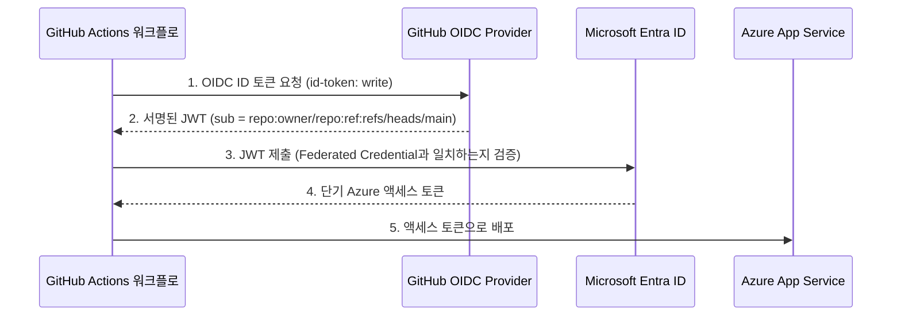

# 🔐 Azure Secretless CI/CD Hands-on Lab

🌐 **한국어** | [English](README.en.md)

GitHub Actions에서 Azure로 앱을 배포할 때 **비밀번호·키·Publish Profile 같은 시크릿을 한 줄도 저장하지 않는(secretless)** 방법을 직접 따라 하며 배우는 실습입니다.

- ⏱ 소요 시간: 약 40분
- 💰 비용: App Service B1 (실습 후 삭제하면 몇백 원 수준). `SKU=F1`로 무료 플랜 사용도 가능(구독 쿼터에 따라 불가할 수 있음)
- 🧰 기술: GitHub Actions, Azure App Service, Microsoft Entra ID **Workload Identity Federation (OIDC)**

## 1. 왜 Secretless인가?

| | 기존 방식 (Service Principal 비밀번호 / Publish Profile) | **Secretless (OIDC)** |
|---|---|---|
| GitHub에 저장하는 것 | 장기 유효 시크릿 | **없음** (ID 값만 저장, 비밀 아님) |
| 유출 시 위험 | 만료 전까지 누구나 Azure 접근 | 토큰이 몇 분 뒤 만료, 특정 repo/branch에서만 발급 |
| 시크릿 로테이션 | 주기적으로 직접 교체 | **불필요** |
| 접근 범위 제한 | 어려움 | repo/branch/environment 단위로 제한 |

### 동작 원리



핵심: Azure가 **"이 GitHub repo의 main 브랜치에서 온 워크플로라면 신뢰한다"** 고 미리 등록(Federated Credential)해 두므로, 비밀번호를 주고받을 필요가 없습니다.

## 2. 구성 요소

```
.
├── .devcontainer/               # Codespaces 개발 환경 (az, gh, Node 22)
├── app/                         # 샘플 Node.js 앱 (외부 의존성 없음)
├── .github/workflows/deploy.yml # 빌드 → 테스트 → OIDC 로그인 → 배포
├── scripts/setup-azure.sh       # (선택) Azure 설정 자동화 스크립트
└── scripts/cleanup-azure.sh     # 실습 리소스 정리
```

## 3. 사전 준비

- Azure 구독 (리소스 생성 및 **Entra ID 앱 등록** 권한, 구독 `Owner` 또는 `User Access Administrator` 필요)
- GitHub 계정
- **GitHub Codespaces (권장)** — `az`, `gh`, Node.js 22이 미리 설치된 개발 환경이 자동으로 구성됩니다. (대안: [Azure Cloud Shell](https://shell.azure.com) 또는 로컬 `az` CLI 2.60+)

## 4. 실습

### Step 0. 내 저장소 만들기

1. 이 저장소 상단의 **Use this template**(또는 **Fork**) 로 본인 계정에 저장소를 만듭니다.
2. 저장소 이름을 확인합니다. 이후 `<OWNER>/<REPO>` 로 표기합니다. 예: `octocat/azure-secretless-cicd-lab`

> Fork한 저장소는 보안상 Actions가 꺼져 있습니다. **Actions** 탭에서 *I understand my workflows, go ahead and enable them* 을 눌러 활성화하세요.

**Codespaces 열기:** 내 저장소에서 **Code → Codespaces → Create codespace on main** 을 클릭합니다. (템플릿 원본이 아니라 **본인이 만든 저장소**에서 여세요.)

[](https://codespaces.new/Taeyangmoon/azure-secretless-cicd-lab) ← 원본 저장소에서 바로 열어 둘러볼 때만 사용

Codespaces 터미널에서 Azure에 로그인합니다 (브라우저 팝업이 없으므로 device code 방식 사용).

```bash
az login --use-device-code
az account show -o table      # 올바른 구독인지 확인
```

> 💡 앱을 로컬에서 미리 보려면 `cd app && npm start` 후 알림의 포트 8080 링크를 여세요.

터미널에서 변수를 준비합니다 (이후 모든 명령에서 사용).

```bash
GITHUB_REPO="${GITHUB_REPOSITORY:-<OWNER>/<REPO>}"   # Codespaces에서는 자동으로 채워짐
RG="rg-secretless-lab"
LOCATION="koreacentral"
APP_NAME="secretless-lab-$RANDOM$RANDOM"   # 전역에서 유일해야 함
```

> ⚡ **빠른 길:** Step 1~3을 한 번에 끝내려면 `./scripts/setup-azure.sh` (Codespaces 외 환경에서는 `GITHUB_REPO=<OWNER>/<REPO> ./scripts/setup-azure.sh`) 를 실행하고 Step 4로 가세요. 원리를 이해하려면 아래를 한 단계씩 따라 하길 권장합니다.

### Step 1. Azure Web App 만들기

```bash
az group create -n $RG -l $LOCATION
az appservice plan create -g $RG -n plan-$APP_NAME --is-linux --sku B1
az webapp create -g $RG -p plan-$APP_NAME -n $APP_NAME --runtime "NODE:22-lts"
```

브라우저에서 `https://$APP_NAME.azurewebsites.net` 을 열어 기본 페이지가 뜨는지 확인합니다.

### Step 2. Entra ID 앱 등록 + Federated Credential (⭐ 핵심)

GitHub Actions가 Azure에서 사용할 "신원(Identity)"을 만들고, **어떤 GitHub 워크플로를 신뢰할지** 등록합니다.

```bash
# 1) 앱 등록 및 서비스 주체 생성
CLIENT_ID=$(az ad app create --display-name "sp-github-$APP_NAME" --query appId -o tsv)
az ad sp create --id $CLIENT_ID

# 2) subject prefix 조회 (신규 저장소는 repo:<OWNER>@<ID>/<REPO>@<ID> 처럼 불변 ID가 포함될 수 있음)
SUB_PREFIX=$(gh api repos/$GITHUB_REPO/actions/oidc/customization/sub --jq .sub_claim_prefix 2>/dev/null || echo "repo:$GITHUB_REPO")
echo $SUB_PREFIX

# 3) Federated Credential: "이 repo의 main 브랜치를 신뢰한다"
az ad app federated-credential create --id $CLIENT_ID --parameters '{
  "name": "github-main",
  "issuer": "https://token.actions.githubusercontent.com",
  "subject": "'$SUB_PREFIX':ref:refs/heads/main",
  "audiences": ["api://AzureADTokenExchange"]
}'
```

| 항목 | 의미 |
|---|---|
| `issuer` | 토큰을 발급하는 GitHub OIDC Provider |
| `subject` | **누구에게** 신뢰를 줄지. repo + 브랜치가 정확히 일치해야 함 |
| `audiences` | Azure AD 토큰 교환용 고정 값 |

> ✅ 비밀번호(`--password`, `az ad sp create-for-rbac` 의 secret)를 **만들지 않았다**는 점에 주목하세요.

### Step 3. 최소 권한 부여

배포 대상 **Web App 하나**에만 권한을 줍니다 (구독 전체 `Contributor` 는 과합니다).

```bash
SP_OBJECT_ID=$(az ad sp show --id $CLIENT_ID --query id -o tsv)
WEBAPP_ID=$(az webapp show -g $RG -n $APP_NAME --query id -o tsv)

az role assignment create \
  --assignee-object-id $SP_OBJECT_ID \
  --assignee-principal-type ServicePrincipal \
  --role "Website Contributor" \
  --scope $WEBAPP_ID
```

### Step 4. GitHub에 설정 값 등록 (Secrets가 아닌 **Variables**)

값 출력:

```bash
echo "AZURE_CLIENT_ID       = $CLIENT_ID"
echo "AZURE_TENANT_ID       = $(az account show --query tenantId -o tsv)"
echo "AZURE_SUBSCRIPTION_ID = $(az account show --query id -o tsv)"
echo "AZURE_WEBAPP_NAME     = $APP_NAME"
```

GitHub 저장소 → **Settings → Secrets and variables → Actions → Variables 탭 → New repository variable** 로 위 4개를 등록합니다.

또는 `gh` CLI:

> ⚠️ Codespaces의 기본 `GITHUB_TOKEN` 은 Variables를 만들 권한이 없습니다. 먼저 `unset GITHUB_TOKEN && gh auth login -h github.com -p https -w` 로 로그인하거나, 위의 웹 UI 방법을 사용하세요.

```bash
gh variable set AZURE_CLIENT_ID       --body "$CLIENT_ID" -R $GITHUB_REPO
gh variable set AZURE_TENANT_ID       --body "$(az account show --query tenantId -o tsv)" -R $GITHUB_REPO
gh variable set AZURE_SUBSCRIPTION_ID --body "$(az account show --query id -o tsv)" -R $GITHUB_REPO
gh variable set AZURE_WEBAPP_NAME     --body "$APP_NAME" -R $GITHUB_REPO
```

> 💡 Client ID / Tenant ID / Subscription ID 는 **식별자일 뿐 비밀이 아닙니다.** 이 값만으로는 Azure에 로그인할 수 없고, 신뢰된 repo/branch의 워크플로가 발급받은 OIDC 토큰이 있어야 합니다. 그래서 **Secrets 탭은 비어 있어야 정상**입니다.

### Step 5. 워크플로 살펴보기

[`.github/workflows/deploy.yml`](.github/workflows/deploy.yml) 에서 secretless의 핵심은 두 곳입니다.

```yaml
deploy:
  permissions:
    id-token: write     # ① GitHub에게 OIDC 토큰 발급을 요청할 권한
    contents: read
  steps:
    - uses: azure/login@v2   # ② 시크릿 없이 ID 값만 전달
      with:
        client-id: ${{ vars.AZURE_CLIENT_ID }}
        tenant-id: ${{ vars.AZURE_TENANT_ID }}
        subscription-id: ${{ vars.AZURE_SUBSCRIPTION_ID }}
```

`password`, `creds`(JSON), `publish-profile` 같은 입력이 **어디에도 없습니다.**

### Step 6. 배포 실행

1. 저장소의 `app/server.js` 의 문구를 조금 수정해 `main` 에 커밋/푸시하거나, **Actions → Build and Deploy (secretless) → Run workflow** 를 클릭합니다.
2. Actions 탭에서 `build` → `deploy` 잡이 성공하는지 확인합니다.
3. `https://<APP_NAME>.azurewebsites.net` 을 열어 배포된 **Commit / Run ID** 가 표시되는지 확인합니다. `/api/info`, `/healthz` 도 확인해 보세요.

### Step 7. 검증 — 정말 secretless 인가?

- **Settings → Secrets and variables → Actions → Secrets**: 등록된 시크릿이 **0개**
- Azure Portal → Microsoft Entra ID → 앱 등록 → `sp-github-…` → **Certificates & secrets**: Client secret **0개**, **Federated credentials** 1개
- `Azure login (OIDC)` 단계 로그에 `Federated token details` 가 보이고 비밀번호는 없음

### Step 8. 🧪 신뢰 경계 체험 (보너스)

Federated Credential이 **브랜치까지 정확히** 확인한다는 걸 직접 확인해 봅니다.

1. `test-branch` 브랜치를 만들고 `deploy.yml` 의 트리거를 `branches: [main, test-branch]` 로 수정하여 푸시합니다.
2. `deploy` 잡이 `AADSTS700213: No matching federated identity record found` 오류로 **실패**합니다. subject가 `...refs/heads/test-branch` 로 등록되지 않았기 때문입니다. 
3. 이것이 secretless의 보안 이점입니다. 허용하지 않은 브랜치/포크에서는 토큰이 있어도 Azure에 로그인할 수 없습니다.

더 엄격하게 하려면 GitHub **Environment**(예: `production`, 승인 필요)를 만들고 subject를 `$SUB_PREFIX:environment:production` 으로 등록한 뒤 deploy 잡에 `environment: production` 을 추가하세요.

## 5. 정리 (비용 방지)

```bash
APP_NAME=$APP_NAME RG=$RG ./scripts/cleanup-azure.sh
# 또는 수동
az ad app delete --id $CLIENT_ID
az group delete -n $RG --yes --no-wait
```

## 6. 문제 해결

| 증상 | 원인 / 해결 |
|---|---|
| `AADSTS700213` / `No matching federated identity record` | subject 불일치. 실패 로그의 `presented assertion subject '...'` 값과 등록한 subject를 비교하세요. 신규 저장소는 `repo:<OWNER>@<ID>/<REPO>@<ID>` 형태(불변 ID)일 수 있습니다 (`SUB_PREFIX` 조회 참고). 대소문자, 브랜치명, environment 사용 여부도 확인 |
| `Error: Login failed … client-id` 가 비어 있음 | Variables 4개 등록 확인 (Secrets 탭이 아닌 **Variables** 탭) |
| `AuthorizationFailed` | 역할 할당 전파에 최대 몇 분 소요. 잠시 후 재실행. scope가 올바른 Web App인지 확인 |
| `Unable to get ACTIONS_ID_TOKEN_REQUEST_URL` | deploy 잡에 `permissions: id-token: write` 가 없음 |
| `az ad app create` 권한 오류 | Entra ID 앱 등록 권한 필요. 테넌트 관리자에게 문의하거나 개인 구독 사용 |
| F1 플랜 생성 실패 | 구독 쿼터 문제. `SKU=B1` 사용 |
| Fork 저장소에서 워크플로가 안 돎 | Actions 탭에서 워크플로 활성화 |

## 7. 더 알아보기

- [GitHub Docs – OpenID Connect in Azure](https://docs.github.com/actions/how-tos/secure-your-work/security-harden-deployments/oidc-in-azure)
- [Microsoft Learn – Workload identity federation](https://learn.microsoft.com/entra/workload-id/workload-identity-federation)
- [azure/login](https://github.com/Azure/login) · [azure/webapps-deploy](https://github.com/Azure/webapps-deploy)

## 라이선스

[MIT](LICENSE)
